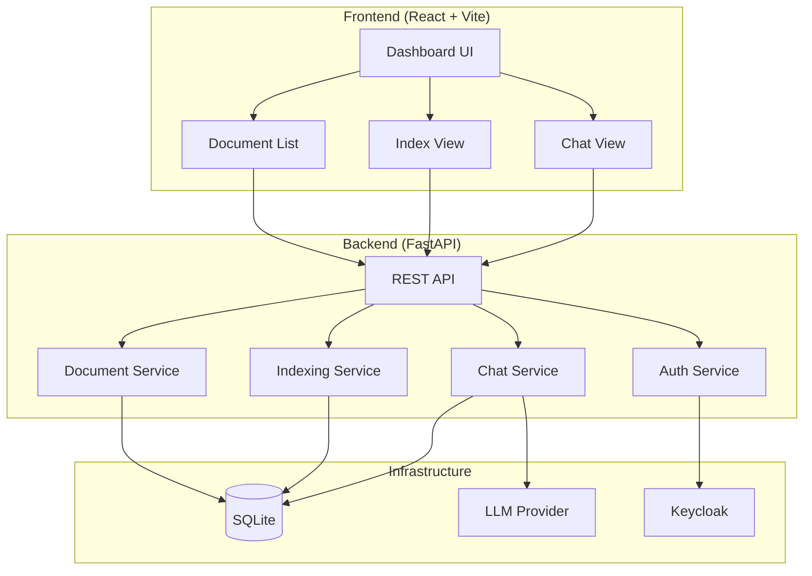

# PageIndex: Document Index for Vectorless, Reasoning-based RAG — Ryan Vo

> Work in progress. This checkpoint may be incomplete or fail tests. See PLAN.md and STATUS.md before use.


**Ryan Vo | AI & Machine Learning**  
ryandtvo@gmail.com

---

## Overview

PageIndex is a document indexing and retrieval system designed for vectorless, reasoning-based RAG (Retrieval-Augmented Generation). It builds hierarchical document indexes from PDFs and other documents, enabling efficient navigation, search, and chat-based question answering over document content.

### Key Features

- **Hierarchical Document Indexing**: Automatic tree structure extraction from documents with chapter/section detection
- **Incremental Index Updates**: Node-level content hashing detects changes; only affected subtrees are rebuilt
- **Document Version History**: Track changes across document versions with change summaries
- **Vectorless Search**: Text-based search across index nodes with match type highlighting
- **Chat with Documents**: LLM-powered chat over indexed documents with per-call usage tracking
- **OIDC Authentication**: Keycloak integration with SAML broker support

---

## Architecture



---

## Quick Start

### Prerequisites

- Docker & Docker Compose
- Python 3.12+ (for local development)
- Node 24+ (for local development)

### Using Docker Compose

```bash
# Copy environment template
cp .env.example .env

# Edit .env with your settings (LLM_API_KEY for AI features)
# Start all services
docker-compose up -d

# Access:
# Frontend: http://localhost:5173
# Backend API: http://localhost:8000/api/v1
# Keycloak: http://localhost:8080 (admin/admin)
```

### Local Development

**Backend:**
```bash
cd backend
python -m venv .venv
source .venv/bin/activate
pip install -r requirements.txt
cp ../.env.example .env
# Edit .env
uvicorn app.main:app --reload --host 0.0.0.0 --port 8000
```

**Frontend:**
```bash
cd frontend
npm install
npm run dev
```

---

## API Reference

### Health
- `GET /api/v1/health` - Service health check

### Documents
- `POST /api/v1/documents/upload` - Upload document (multipart/form-data)
- `GET /api/v1/documents` - List documents (pagination: skip, limit)
- `GET /api/v1/documents/{id}` - Get document details
- `POST /api/v1/documents/{id}/index` - Build full index
- `POST /api/v1/documents/{id}/incremental-update` - Incremental update (multipart/form-data)
- `GET /api/v1/documents/{id}/versions` - Get version history

### Index
- `GET /api/v1/index/{doc_id}/tree` - Get full index tree
- `GET /api/v1/index/{doc_id}/leaves` - Get leaf nodes
- `GET /api/v1/index/{doc_id}/search?q={query}&limit={n}` - Search index
- `GET /api/v1/index/{doc_id}/nodes/{node_id}` - Get node detail

### Chat
- `POST /api/v1/chat` - Send chat message
- `GET /api/v1/chat/sessions` - List chat sessions
- `GET /api/v1/chat/sessions/{id}` - Get session with messages

---

## AI/ML Evaluation

### Implemented AI/ML Workflow

PageIndex implements a **hierarchical document indexing pipeline** with incremental updates:

1. **Document Ingestion**: PDF/text parsing with structure detection
2. **Tree Building**: Heuristic chapter/section hierarchy construction
3. **Content Hashing**: SHA-256 per node for change detection
4. **Incremental Updates**: Diff new version against existing tree; rebuild only changed subtrees
5. **Summary Propagation**: Invalidate and regenerate summaries up the ancestor chain

### Reproducible Baseline

```bash
# Run indexing on sample document
curl -X POST http://localhost:8000/api/v1/documents/upload -F "file=@sample.pdf"
curl -X POST http://localhost:8000/api/v1/documents/1/index

# Run incremental update
curl -X POST http://localhost:8000/api/v1/documents/1/incremental-update -F "file=@sample_v2.pdf"
```

### Metrics (Manual Testing)

| Operation | Document Size | Time (approx) | Nodes Changed |
|-----------|---------------|---------------|---------------|
| Full Index | 5 pages | ~2s | N/A (all new) |
| Incremental Update | 5 pages, 2 changed | ~0.5s | 2 leaf + ancestors |

### Limitations

- Structure detection uses simple heuristics (not LLM-based)
- No vector embeddings or semantic search yet
- LLM chat integration is mocked (requires API key)
- No PDF parsing library integrated (uses mock data)

---

## Configuration

| Variable | Description | Default |
|----------|-------------|---------|
| `DATABASE_URL` | SQLite database URL | `sqlite+aiosqlite:///./pageindex.db` |
| `KEYCLOAK_URL` | Keycloak base URL | `http://localhost:8080` |
| `KEYCLOAK_REALM` | Keycloak realm | `pageindex` |
| `KEYCLOAK_CLIENT_ID` | OIDC client ID | `pageindex-client` |
| `KEYCLOAK_CLIENT_SECRET` | OIDC client secret | *(required for production)* |
| `LLM_API_KEY` | LLM provider API key | *(optional)* |
| `LLM_PROVIDER` | Provider type | `openai-compatible` |
| `LLM_MODEL` | Model name | `gpt-4o-mini` |
| `LLM_BASE_URL` | Provider base URL | `https://api.openai.com/v1` |
| `CORS_ORIGINS` | Allowed CORS origins | `["http://localhost:5173"]` |
| `DEBUG` | Debug mode | `false` |

---

## Deployment

### TLS Reverse Proxy (Required for Production)

```nginx
server {
    listen 443 ssl http2;
    server_name your-domain.com;

    ssl_certificate /path/to/cert.pem;
    ssl_certificate_key /path/to/key.pem;

    location / {
        proxy_pass http://localhost:5173;
        proxy_set_header Host $host;
        proxy_set_header X-Real-IP $remote_addr;
    }

    location /api {
        proxy_pass http://localhost:8000;
        proxy_set_header Host $host;
        proxy_set_header X-Real-IP $remote_addr;
    }
}
```

### Backup/Restore

```bash
# Backup SQLite database
cp backend/pageindex.db pageindex_backup_$(date +%Y%m%d).db

# Restore
cp pageindex_backup_20240101.db backend/pageindex.db
```

### Keycloak SAML Broker Setup

1. Create Identity Provider in Keycloak: SAML v2.0
2. Configure SAML settings from your IdP
3. Map SAML attributes to Keycloak user attributes
4. Set as default identity provider for realm

---

## Development

### Running Tests

```bash
# Backend tests
cd backend
.venv/bin/python -m pytest tests/ -v

# Frontend tests
cd frontend
npm test
```

### Code Structure

```
backend/
├── app/
│   ├── main.py              # FastAPI app factory
│   ├── core/
│   │   ├── config.py        # Settings
│   │   └── database.py      # DB connection
│   ├── models/
│   │   └── __init__.py      # SQLAlchemy models
│   ├── api/routes/
│   │   ├── health.py
│   │   ├── documents.py
│   │   ├── index.py
│   │   ├── chat.py
│   │   └── auth.py
│   └── services/
│       ├── indexing.py      # Core indexing logic
│       └── chat.py          # Chat with usage tracking
└── tests/

frontend/
├── src/
│   ├── components/          # React components
│   ├── hooks/               # Custom hooks
│   ├── api/                 # API client
│   ├── types/               # TypeScript types
│   └── __tests__/           # Vitest tests
```

---

## Security Limitations

- **Demo mode**: Runs without authentication when `DEMO_MODE=true` (localhost only)
- **No HTTPS locally**: TLS termination must be handled by reverse proxy
- **SQLite**: Not suitable for high-concurrency production; migrate to PostgreSQL
- **LLM keys**: Stored in environment variables only; never logged
- **Keycloak**: Dev configuration uses default admin/admin; change in production

---

## License

MIT License — Copyright (c) 2024 Ryan Vo <ryandtvo@gmail.com>

---

## Changelog

### 1.0.0 (2024-10-22)
- Initial release
- Hierarchical document indexing with tree structure
- Incremental index updates with content hashing
- Document version history
- Chat interface with usage tracking
- Keycloak OIDC authentication ready
- Docker Compose deployment
- CI/CD pipeline